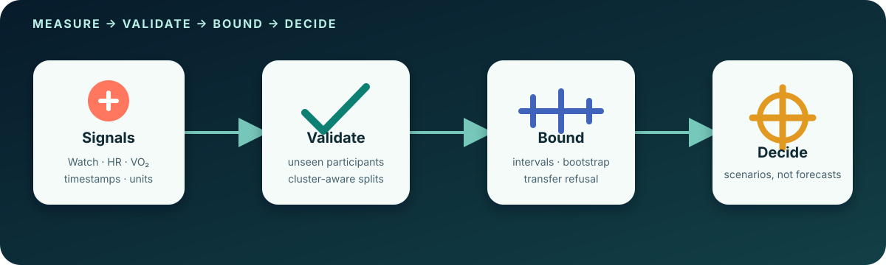
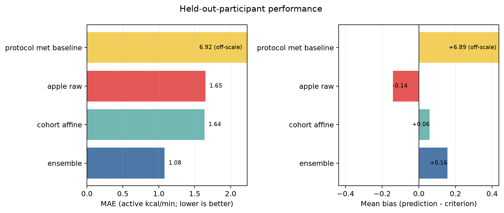
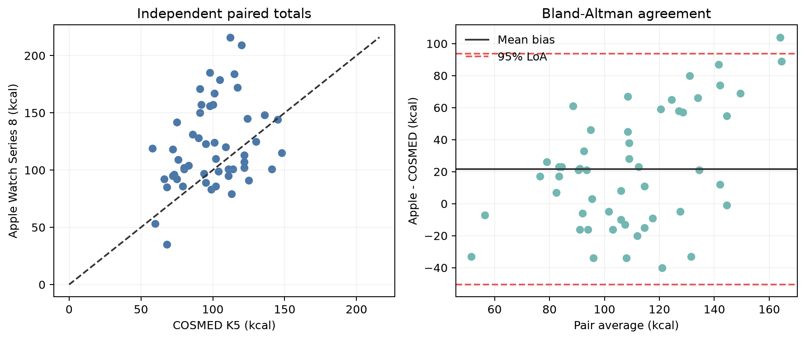
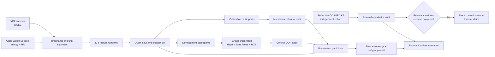

# DeficitLens for Apple Watch

**How accurately does an Apple Watch estimate energy use for someone new?**

[](https://github.com/limingrui679-design/deficitlens-apple-watch/actions/workflows/ci.yml)
[](https://github.com/limingrui679-design/deficitlens-apple-watch/actions/workflows/security.yml)
[](https://github.com/limingrui679-design/deficitlens-apple-watch/releases)



Two people can record the same active calories on a watch and expend different amounts of energy. DeficitLens lets wearable-data researchers compare the watch reading with a laboratory reference. It aligns Apple Watch signals with oxygen uptake, trains correction models on other participants, and evaluates each person in turn.

Across 17 participants and six activities in the WEEE dataset, the raw Series 6 readings had a mean absolute error of 1.651 kcal/min. The model brought that to 1.082 kcal/min. The report breaks error down by activity and shows how the remaining uncertainty changes a planning scenario. [Explore the held-out results](artifacts/verified/report.html)

[Open the verified report](artifacts/verified/report.html) ·
[Read the methodology](docs/methodology.md) ·
[Explore the case paths](docs/case-paths.md) ·
[Inspect the model card](docs/model-card.md) ·
[中文概览](docs/README.zh-CN.md)

## Why this project exists

Researchers can follow the calculation from an Apple Health export to a participant-level comparison. The workflow

- parses Apple Health `export.xml` with unit normalization, de-duplication, source filtering,
  local-day preservation, and privacy-safe aggregation;
- uses Apple Watch Series 6 second-level signals in WEEE for model development;
- audits Series 8 session totals against COSMED K5 in an independent 2026 cohort;
- treats missing heart-rate samples as signal quality, not as silent zeros;
- compares the learned correction with the raw Apple value and transparent baselines;
- propagates measurement error through explicit energy-balance scenarios.

## Case paths

One pipeline supports four genuinely different questions. The catalog is validated, included in
the wheel, exposed by `deficitlens cases`, and rendered into the report.

| Path | Question | Evidence state | Hard boundary |
|---|---|---|---|
| Series 6 criterion benchmark | Can a correction improve held-out error in the registered protocol? | Observed benchmark | 17 controlled-activity participants; no universal calibration |
| Series 8 device-agreement audit | Does raw Watch session energy agree with COSMED K5? | Observed external audit | No correction-model transfer because required features are absent |
| Local Apple Health audit | What can be learned without uploading or writing raw rows? | Private local workflow | Descriptive aggregates and scenarios only |
| Exercise-energy sensitivity | When could persistent error matter to a planning calculation? | Modeled scenario | Arithmetic sensitivity, never a weight forecast |

These paths cover statistical research, AI/model validation, privacy-preserving health
informatics, data governance, and risk/decision analysis without pretending that one dataset
supports every claim. See the [evidence-state contract](docs/evidence-levels.md).

## Verified snapshot

The committed evidence bundle is generated from two public datasets and contains row-level
outer-fold predictions, aggregate tables, figures, fold diagnostics, and SHA-256 hashes. Every
WEEE participant is held out exactly once. Results in this section are updated only by the
verified pipeline; see [`run_manifest.json`](artifacts/verified/run_manifest.json) for runtime,
versions, checksums, and claim boundaries.

| Evidence layer | Scope |
|---|---:|
| WEEE criterion benchmark | 17 participants, 6 activities |
| Primary independent Series 8 audit | 52 paired participants after the paper's global exclusion |
| Primary modeling unit | non-overlapping 30-second windows |
| Data-density sensitivity | 30-second windows at a 5-second stride, still split by participant |
| Outer validation | leave one participant out |
| Uncertainty | participant-disjoint split conformal, Mondrian by activity where supported |

The report is the source of truth for numerical results. The quality score is a release-gate
score for evidence and engineering completeness; it is **not** a claim of perfect predictive
accuracy.

### Current held-out results

| Estimator | MAE (kcal/min) | Participant-clustered 95% CI | Mean bias | R² |
|---|---:|---:|---:|---:|
| Apple Watch raw | 1.651 | [1.366, 1.945] | -0.142 | 0.173 |
| Cohort affine correction | 1.636 | [1.410, 1.861] | +0.059 | 0.375 |
| DeficitLens convex ensemble | **1.082** | **[0.875, 1.305]** | +0.156 | **0.604** |

The ensemble reduced MAE by **34.5%** relative to the raw Watch field in outer participant-held-
out predictions. Its participant-cluster conformal interval reached **96.4%** empirical coverage
for a 90% target, at a mean width of 5.19 kcal/min. The narrower row-calibrated interval covered
only 84.6%; it is kept as a diagnostic to show why repeated windows cannot be treated as
independent.



In the independent Series 8 cohort, raw Apple session totals had MAE **33.63 kcal**, mean bias
**+21.60 kcal**, and MAPE **35.7%** against COSMED K5 for 52 primary paired participants. This is
an external *device audit*, not a transfer result for the WEEE-trained ensemble. Participant-
bootstrap 95% intervals were **[26.67, 40.83] kcal** for MAE and **[12.38, 31.64] kcal** for mean
bias; a machine-readable failed transfer gate is included in the report.



## Method at a glance



The outer test participant appears in none of base-model fitting, stack-weight learning, or
interval calibration. Inner folds preserve participant groups. Bootstrap intervals resample
whole participants because adjacent wearable windows are correlated.

## Quick start

Python 3.10–3.12 is supported.

```bash
python -m venv .venv
source .venv/bin/activate
python -m pip install -e ".[dev]"

# Safe, tiny, synthetic Apple Health smoke test
deficitlens demo --output artifacts/demo

# Inspect evidence-bounded use cases and their claim limits
deficitlens cases

# Inspect external review, reproduction, user, deployment, adoption, and impact counts
deficitlens evidence

# Inspect registered public and restricted sources
deficitlens registry
```

Download the two public benchmark inputs with checksum verification:

```bash
deficitlens fetch weee --output data/raw/weee
deficitlens fetch apple_watch_paee_2026 --output data/raw/paee2026
```

Run the full verified analysis:

```bash
deficitlens benchmark \
  --weee data/raw/weee/dataset.zip \
  --paee2026 "data/raw/paee2026/All Subject Level Data one place.xlsx" \
  --output artifacts/verified
```

Raw public inputs are intentionally gitignored. Their expected sizes and hashes live in
[`data/registry.yml`](data/registry.yml).

## Audit your own Apple Health export locally

On iPhone, export Health data and copy `apple_health_export/export.xml` to a local folder. Then:

```bash
deficitlens apple-health \
  --xml /private/path/to/apple_health_export/export.xml \
  --output /private/path/to/my-audit
```

Defaults are intentionally conservative:

- only Apple Watch records are included;
- energy is normalized to dietary kcal;
- source names are hashed in memory;
- raw rows, record IDs, exact timestamps, and device strings are not written;
- output contains an offline `index.html`, daily/workout aggregates, and labeled ±10%/±20%
  sensitivity scenarios only.

Apple's export steps are documented in the [iPhone User Guide](https://support.apple.com/guide/iphone/share-your-health-data-iph5ede58c3d/ios), and the modeled Watch field corresponds to HealthKit's [`activeEnergyBurned`](https://developer.apple.com/documentation/healthkit/hkquantitytypeidentifier/activeenergyburned).

## Algorithms that earn their place

1. **Physiology-aware alignment.** VO₂ in mL/kg/min is converted with an explicit 5 kcal/L O₂
   approximation. Mifflin–St Jeor resting expenditure is subtracted to align total criterion
   expenditure with Apple's *active* energy concept.
2. **Nested group cross-fitting.** Ridge, Extra Trees, and histogram gradient boosting create
   out-of-fold predictions in participant-preserving inner folds.
3. **Constrained stacking.** SLSQP learns non-negative weights summing to one. A complex learner
   can receive zero weight when it adds no held-out value.
4. **Finite-sample cluster conformal prediction.** Calibration residuals are maximized within
   participant before applying the corrected `ceil((n+1)(1-alpha))` rank. Radii use only the
   deployable `rest/cycling/running` activity family and require enough calibration participants;
   otherwise the global radius is used.
5. **Bayesian personalization.** An optional one-state Kalman bias corrector updates only after a
   genuine paired criterion session. It does not mistake scale change for sensor ground truth.
6. **Participant-clustered inference.** Confidence intervals resample people, not correlated
   windows.
7. **Decision-impact analysis.** Measurement error is propagated across 3/5/7 active days per
   week, 30/45/60 minutes, 4/8/12 weeks, and 7,000/7,700/9,000 kcal/kg assumptions, with metabolic
   adaptation explicitly outside scope.

## Repository map

```text
src/deficitlens/
  data/          # WEEE, 2026 PAEE, registry, Apple Health adapters
  models/        # baselines, grouped stack, conformal and Kalman calibration
  evaluation/    # metrics, cluster bootstrap, transfer gate, fairness, decisions
  reporting/     # figures and portable HTML evidence report bundle
cases/           # validated school-neutral case and capability catalog
evidence/        # explicit external review/adoption/impact ledger
tests/           # unit, adversarial, CLI and optional real-data integration tests
scripts/         # release, safety, docs, archive, and quality verification
artifacts/
  verified/      # committed aggregate evidence, figures, report and manifest
docs/            # data cards, methodology, model card, privacy, validation
```

## Reproduce, test, and audit

```bash
make lint
make typecheck
make coverage
make build
make verify
```

`make verify` writes machine-readable command results. It checks lint, formatting, strict typing,
branch coverage, dependency advisories, private-data/secret risks, local documentation links,
HTML semantics, resource synchronization, distributions, and an isolated installed wheel. The
quality scorer awards points only when the relevant file, evidence artifact, and executed release
check exist. See
[`docs/iteration-log.md`](docs/iteration-log.md) for the score progression and remediation log.

The rubric-v3 score is a **maintainer-controllable release score**, not a scientific accuracy,
popularity, or ecosystem-maturity score. The current verified result is **100/100** with all 16
executed release checks passing and 90.25% branch-aware coverage. External evidence is reported
separately.

## External evidence and publication status

The canonical public repository is
[`limingrui679-design/deficitlens-apple-watch`](https://github.com/limingrui679-design/deficitlens-apple-watch).
Its URL and default branch were verified before being added to package and citation metadata. As of
2026-08-23, the [external evidence ledger](evidence/external-evidence.json) records:

- 0 independent method reviews and 0 independent reproductions;
- 0 structured usability or accessibility-study participants;
- 0 documented real users, production deployments, or organizational adoptions; and
- 0 real-world impact evaluations; the observed public Star count is 0.

Internal tests, self-audits, synthetic demos, and public-dataset analyses are valuable evidence,
but they do not become external adoption or impact. Remote CI, repository security settings,
independent review, and user studies remain separately verifiable on the [roadmap](ROADMAP.md).

## Data provenance

- **WEEE**: Robert Bosch GmbH research dataset, 17 participants, Apple Watch Series 6 and
  indirect-calorimetry VO₂ among multiple modalities. [Data record](https://doi.org/10.5281/zenodo.6420886) · [Scientific Data paper](https://doi.org/10.1038/s41597-022-01643-5) · CC BY 4.0.
- **Apple Watch PAEE 2026**: 58 enrolled Hispanic adults; 53 paired Apple–COSMED records are
  present after missingness and 52 enter the paper-mirrored primary analysis. [OSF files](https://osf.io/e745u/) · [PLOS ONE article](https://doi.org/10.1371/journal.pone.0353261) · CC BY 4.0.
- **BigIdeasLab_STEP**: optional Apple Watch 4 heart-rate fairness source, 53 participants.
  It is registered for methodological extension but not downloaded or used because PhysioNet
  requires an account and signed agreement. [PhysioNet record](https://physionet.org/content/bigideaslab-step-hr-smartwatch/1.0/).

No raw third-party data is redistributed. Derived predictions retain attribution and source
hashes in the evidence bundle.

## Important limitations

- Seventeen development participants are enough for an honest benchmark, not a universal
  calibration claim.
- WEEE uses Series 6 under controlled activities; the external Series 8 cohort audits raw device
  error but cannot validate transfer of the WEEE-trained model because it lacks matching features;
  the pipeline records this as `blocked_model_transfer` rather than leaving it to prose.
- WEEE supplies VO₂ but not VCO₂, so 5 kcal/L O₂ is an approximation; RMR is estimated, not
  directly measured.
- Skin-tone conclusions are not transferred across datasets. WEEE lacks Fitzpatrick labels; the
  2026 audit is reported independently.
- Percentage errors near zero active energy are unstable; MAPE excludes criterion rates below
  0.5 kcal/min and reports its denominator.
- A kcal/kg conversion is a scenario parameter, not a physiological law or forecast.

Read the full [model card](docs/model-card.md) before reuse.

## License and citation

Code is Apache-2.0. Dataset licenses remain with their creators. Cite DeficitLens via
[`CITATION.cff`](CITATION.cff) and cite each dataset you use. Contributions are welcome under
[`CONTRIBUTING.md`](CONTRIBUTING.md).

### Coverage per window and per person

The benchmark reports pooled window coverage, the mean of each participant's coverage (one vote per person), and the fraction of held-out participants whose every evaluable interval covers the observed value. The last quantity evaluates the simultaneous target of the participant-maximum calibration. It depends on the number and mix of windows observed for each participant. The report supplies both the numerator and the participant count; these are empirical results on the held-out sample.

On the [archived held-out predictions](artifacts/verified/tables/loso_predictions.csv), the primary intervals covered 782 of 811 windows (96.4%). The average within-person coverage was 96.8%, but only 8 of 17 participants had **all** their observed windows covered (47.1%). These denominators are different: a single missed window changes the all-windows result for that person.

### How many people are needed for a simultaneous band?

The nested benchmark reports an additional band covering every window of a new participant. It uses one maximum residual per calibration person, across all activities. At nominal 90%, four independent calibration people permit a finite rank of at most 4/5. The default analysis reports an unavailable finite band, with an explicit reason. Historical capped empirical radii remain available for descriptive comparison.

On the checksummed WEEE archive, a separate 60% calibration split reserved ten people and left six for training in each outer fold. Seventeen of seventeen held-out people had all windows covered. The median radius across folds was 6.05 kcal/min (4.99–8.34); ensemble MAE was 1.122 kcal/min versus 1.082 under the default split and 1.651 for the raw watch. The small cohort and overlapping training folds limit generalisation. Reproduce with the existing `benchmark` command and change only `model.calibration_group_fraction` from 0.20 to 0.60 in a copy of the default configuration. Fold diagnostics record the required order, finite radius or reason, and the held-out participant outcome.
