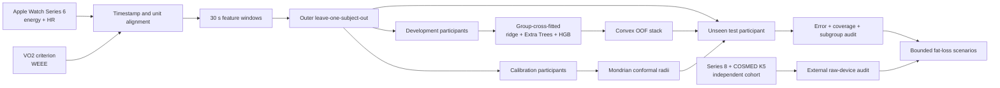

# DeficitLens for Apple Watch

**Measure the measurement before trusting the calorie deficit.**

DeficitLens is a reproducible Apple Watch energy-expenditure audit. It aligns Watch active
energy and heart-rate signals with oxygen-uptake criterion data, predicts measurement error
with a leakage-safe ensemble, wraps estimates in conformal uncertainty intervals, checks
subgroup behavior, and translates remaining error into clearly labeled fat-loss planning
scenarios.

It is an analytics benchmark and local audit tool—not a medical device, diet prescription, or
promise that a wearable can identify a person's true calorie deficit.

[Open the verified report](artifacts/verified/report.html) ·
[Read the methodology](docs/methodology.md) ·
[Inspect the model card](docs/model-card.md) ·
[中文概览](docs/README.zh-CN.md)

## Why this project exists

Most fitness repositories visualize a wearable's calorie field as if it were ground truth.
DeficitLens asks the more useful question: **how wrong might that number be for an unseen
person, and does the error matter for a decision?**

The project is deliberately Apple Watch-specific:

- parses Apple Health `export.xml` with unit normalization, de-duplication, source filtering,
  local-day preservation, and privacy-safe aggregation;
- uses Apple Watch Series 6 second-level signals in WEEE for model development;
- audits Series 8 session totals against COSMED K5 in an independent 2026 cohort;
- treats missing heart-rate samples as signal quality, not as silent zeros;
- compares the learned correction with the raw Apple value and transparent baselines;
- never converts a dashboard state, paper result, or model fit into an individual health claim.

## Verified snapshot

The committed evidence bundle is generated from two public datasets and contains row-level
outer-fold predictions, aggregate tables, figures, fold diagnostics, and SHA-256 hashes. Every
WEEE participant is held out exactly once. Results in this section are updated only by the
verified pipeline; see [`run_manifest.json`](artifacts/verified/run_manifest.json) for runtime,
versions, checksums, and claim boundaries.

| Evidence layer | Scope |
|---|---:|
| WEEE criterion benchmark | 17 participants, 6 activities |
| Primary independent Series 8 audit | 52 paired participants after the paper's global exclusion |
| Primary modeling unit | non-overlapping 30-second windows |
| Data-density sensitivity | 30-second windows at a 5-second stride, still split by participant |
| Outer validation | leave one participant out |
| Uncertainty | participant-disjoint split conformal, Mondrian by activity where supported |

The report is the source of truth for numerical results. The quality score is a release-gate
score for evidence and engineering completeness; it is **not** a claim of perfect predictive
accuracy.

### Current held-out results

| Estimator | MAE (kcal/min) | Participant-clustered 95% CI | Mean bias | R² |
|---|---:|---:|---:|---:|
| Apple Watch raw | 1.651 | [1.366, 1.945] | -0.142 | 0.173 |
| Cohort affine correction | 1.636 | [1.410, 1.861] | +0.059 | 0.375 |
| DeficitLens convex ensemble | **1.082** | **[0.875, 1.305]** | +0.156 | **0.604** |

The ensemble reduced MAE by **34.5%** relative to the raw Watch field in outer participant-held-
out predictions. Its participant-cluster conformal interval reached **96.4%** empirical coverage
for a 90% target, at a mean width of 5.19 kcal/min. The narrower row-calibrated interval covered
only 84.6%; it is kept as a diagnostic to show why repeated windows cannot be treated as
independent.


In the independent Series 8 cohort, raw Apple session totals had MAE **33.63 kcal**, mean bias
**+21.60 kcal**, and MAPE **35.7%** against COSMED K5 for 52 primary paired participants. This is
an external *device audit*, not a transfer result for the WEEE-trained ensemble.


## Method at a glance



The outer test participant appears in none of base-model fitting, stack-weight learning, or
interval calibration. Inner folds preserve participant groups. Bootstrap intervals resample
whole participants because adjacent wearable windows are correlated.

## Quick start

Python 3.10–3.12 is supported.

```bash
python -m venv .venv
source .venv/bin/activate
python -m pip install -e ".[dev]"

# Safe, tiny, synthetic Apple Health smoke test
deficitlens demo --output artifacts/demo

# Inspect registered public and restricted sources
deficitlens registry
```

Download the two public benchmark inputs with checksum verification:

```bash
deficitlens fetch weee --output data/raw/weee
deficitlens fetch apple_watch_paee_2026 --output data/raw/paee2026
```

Run the full verified analysis:

```bash
deficitlens benchmark \
  --weee data/raw/weee/dataset.zip \
  --paee2026 "data/raw/paee2026/All Subject Level Data one place.xlsx" \
  --output artifacts/verified
```

Raw public inputs are intentionally gitignored. Their expected sizes and hashes live in
[`data/registry.yml`](data/registry.yml).

## Audit your own Apple Health export locally

On iPhone, export Health data and copy `apple_health_export/export.xml` to a local folder. Then:

```bash
deficitlens apple-health \
  --xml /private/path/to/apple_health_export/export.xml \
  --output /private/path/to/my-audit
```

Defaults are intentionally conservative:

- only Apple Watch records are included;
- energy is normalized to dietary kcal;
- source names are hashed in memory;
- raw rows, record IDs, exact timestamps, and device strings are not written;
- output contains daily aggregates and ±10%/±20% sensitivity scenarios only.

Apple's export steps are documented in the [iPhone User Guide](https://support.apple.com/guide/iphone/share-your-health-data-iph5ede58c3d/ios), and the modeled Watch field corresponds to HealthKit's [`activeEnergyBurned`](https://developer.apple.com/documentation/healthkit/hkquantitytypeidentifier/activeenergyburned).

## Algorithms that earn their place

1. **Physiology-aware alignment.** VO₂ in mL/kg/min is converted with an explicit 5 kcal/L O₂
   approximation. Mifflin–St Jeor resting expenditure is subtracted to align total criterion
   expenditure with Apple's *active* energy concept.
2. **Nested group cross-fitting.** Ridge, Extra Trees, and histogram gradient boosting create
   out-of-fold predictions in participant-preserving inner folds.
3. **Constrained stacking.** SLSQP learns non-negative weights summing to one. A complex learner
   can receive zero weight when it adds no held-out value.
4. **Finite-sample cluster conformal prediction.** Calibration residuals are maximized within
   participant before applying the corrected `ceil((n+1)(1-alpha))` rank. Radii use only the
   deployable `rest/cycling/running` activity family and require enough calibration participants;
   otherwise the global radius is used.
5. **Bayesian personalization.** An optional one-state Kalman bias corrector updates only after a
   genuine paired criterion session. It does not mistake scale change for sensor ground truth.
6. **Participant-clustered inference.** Confidence intervals resample people, not correlated
   windows.
7. **Decision-impact analysis.** Measurement error is propagated into fixed-assumption exercise
   and mass-equivalent scenarios, with metabolic adaptation explicitly outside scope.

## Repository map

```text
src/deficitlens/
  data/          # WEEE, 2026 PAEE, registry, Apple Health adapters
  models/        # baselines, grouped stack, conformal and Kalman calibration
  evaluation/    # metrics, cluster bootstrap, fairness, decision impact
  reporting/     # figures and portable HTML evidence report bundle
tests/           # unit, adversarial, CLI and optional real-data integration tests
scripts/         # release verification and objective quality scoring
artifacts/
  verified/      # committed aggregate evidence, figures, report and manifest
docs/            # data cards, methodology, model card, privacy, validation
```

## Reproduce, test, and audit

```bash
make lint
make typecheck
make coverage
make build
make verify
```

`make verify` writes machine-readable command results. The quality scorer awards points only
when the relevant file, evidence artifact, and executed release check exist. See
[`docs/iteration-log.md`](docs/iteration-log.md) for the score progression and remediation log.
The final rubric-v2 score is **100/100** after an installed-wheel smoke test; this describes
release completeness, not perfect model accuracy.

## Data provenance

- **WEEE**: Robert Bosch GmbH research dataset, 17 participants, Apple Watch Series 6 and
  indirect-calorimetry VO₂ among multiple modalities. [Data record](https://doi.org/10.5281/zenodo.6420886) · [Scientific Data paper](https://doi.org/10.1038/s41597-022-01643-5) · CC BY 4.0.
- **Apple Watch PAEE 2026**: 58 enrolled Hispanic adults; 53 paired Apple–COSMED records are
  present after missingness and 52 enter the paper-mirrored primary analysis. [OSF files](https://osf.io/e745u/) · [PLOS ONE article](https://doi.org/10.1371/journal.pone.0353261) · CC BY 4.0.
- **BigIdeasLab_STEP**: optional Apple Watch 4 heart-rate fairness source, 53 participants.
  It is registered for methodological extension but not downloaded or used because PhysioNet
  requires an account and signed agreement. [PhysioNet record](https://physionet.org/content/bigideaslab-step-hr-smartwatch/1.0/).

No raw third-party data is redistributed. Derived predictions retain attribution and source
hashes in the evidence bundle.

## Important limitations

- Seventeen development participants are enough for an honest benchmark, not a universal
  calibration claim.
- WEEE uses Series 6 under controlled activities; the external Series 8 cohort audits raw device
  error but cannot validate transfer of the WEEE-trained model because it lacks matching features.
- WEEE supplies VO₂ but not VCO₂, so 5 kcal/L O₂ is an approximation; RMR is estimated, not
  directly measured.
- Skin-tone conclusions are not transferred across datasets. WEEE lacks Fitzpatrick labels; the
  2026 audit is reported independently.
- Percentage errors near zero active energy are unstable; MAPE excludes criterion rates below
  0.5 kcal/min and reports its denominator.
- A kcal/kg conversion is a scenario parameter, not a physiological law or forecast.

Read the full [model card](docs/model-card.md) before reuse.

## License and citation

Code is Apache-2.0. Dataset licenses remain with their creators. Cite DeficitLens via
[`CITATION.cff`](CITATION.cff) and cite each dataset you use. Contributions are welcome under
[`CONTRIBUTING.md`](CONTRIBUTING.md).
